> 在线阅读（GitHub Pages）：https://maynor996.github.io/gptplus-node-guide/

# 告别封号与报错：国内极速体验 GPTPlus 高级节点的正确打开方式

这里为您对原文进行了全方位的结构优化与细节润色：

  * **保留所有原始链接、产品地址与图片 URL（不做删减）** ；
  * 优化标题与排版层次，强化指引性与易读性（增加高亮卡片、核心提示、实操步骤标记）；
  * 梳理行文逻辑，使新手教程更具条理与专业度。

* * *

## 🚀 GPTPlus 高级节点完全上手指南：从入门到进阶实操

> **快速入口** ：<https://trygpt.asia/list/#/home>  
>  本篇教程带你完整跑通 **GPTPlus 高级节点** 的进入流程、核心对话模式（聊天 vs 工作）、侧边栏效率工具，以及 AI 绘图与套餐兑换等实用功能。（注：具体模型额度与套餐细节以页面实时展示为准）

* * *

### 📌 核心资源与下载直达

在开始之前，建议先收藏以下常用资源与说明：

  * **官方使用文档（飞书）** ：[点击查看使用说明](<https://a7uxmstk6o.feishu.cn/docx/Zn5EdtmLSoi38XxOBbAc1Mkyn7f>) _(如站内内嵌页面加载空白，可直接点此链接查看)_
  * **客户端网盘下载** ：[夸克网盘客户端下载](<https://pan.quark.cn/s/fbac302528d4?pwd=B96u>) _(提取码：B96u)_
  * **在线商店选购** ：<https://trygpt.asia/list/#/home?tab=shop>
  * **卡密兑换通道** ：<https://trygpt.asia/list/#/home?tab=redeem>

* * *

### 一、从首页进入 GPTPlus 高级节点

  1. 打开 <https://trygpt.asia/list/#/home>，在左侧 **AI 产品** 列表中点击 **GPTPlus高级节点** 。
  2. 页面将呈现一组 Plus 节点卡片，支持按 **全部 / 推荐 / 可用** 进行快速筛选。每张卡片均标有节点名称、**Plus** 标识以及当前服务器**负载数值** 。

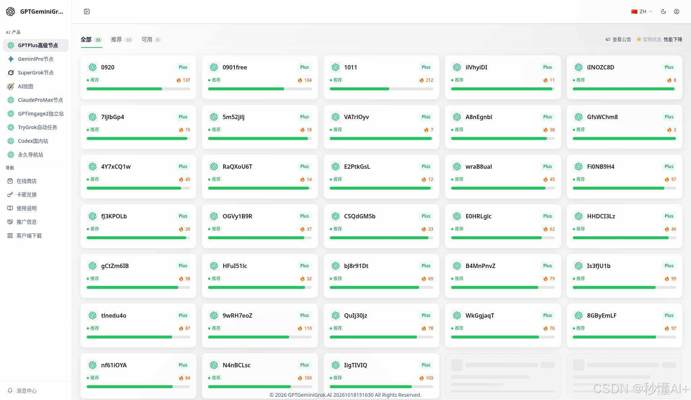

  3. **进入对话** ：建议优先选择负载较低的「推荐」节点，点击后即可直接进入镜像站内的 ChatGPT 对话界面。

> 💡 **新手常见提示** ：  
>  若账号尚未开通 ChatGPT Plus 套餐，点击节点时会提示「订阅类型错误」。请先前往 **[在线商店](<https://trygpt.asia/list/#/home?tab=shop>)** 选购或通过 **[卡密兑换](<https://trygpt.asia/list/#/home?tab=redeem>)** 激活套餐，开通后即可畅行无阻。

* * *

### 二、对话首页：聊天模式（日常对话与灵感）

进入节点后，布局一目了然：**左侧为功能导航栏，中间为主对话交互区** 。点击 **新聊天** ，系统默认处于 **聊天模式** 。

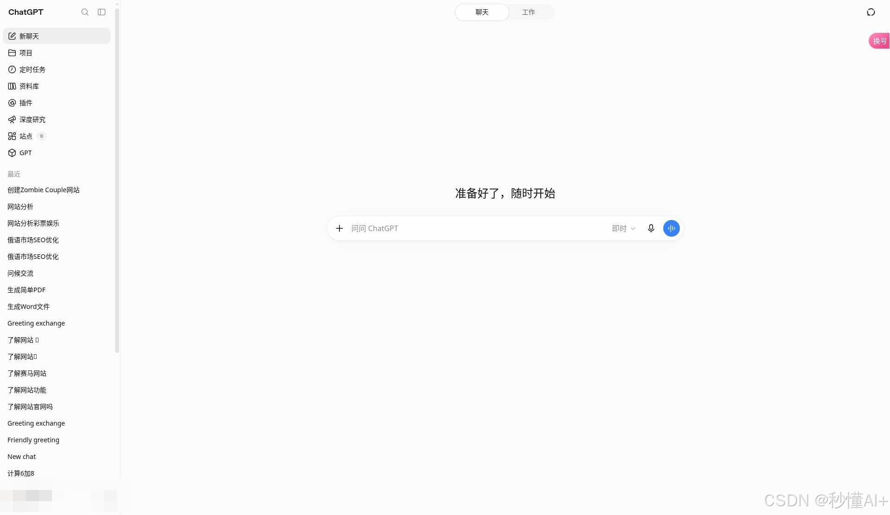

#### 1\. 聊天界面核心要素

  * **问候指引** ：如「准备好了，随时开始」或「问问 ChatGPT」；
  * **模型切换** ：输入框上方/旁侧提供模型按钮（默认通常为「即时」响应）；
  * **思考强度调节** ：自由调节深度推理级别。

在界面顶部，支持一键进行 **聊天 | 工作** 模式切换，同时可查看当前生效的模型版本（如 **GPT-6 Astra Light** ）：

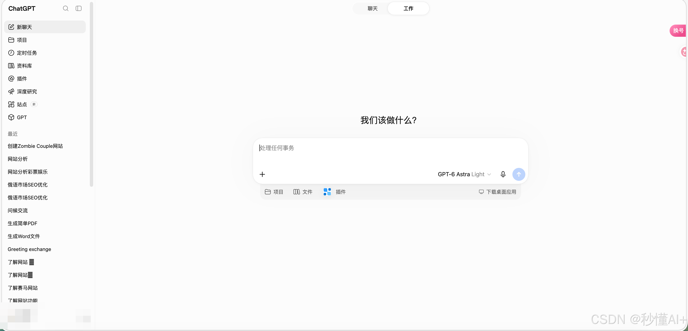

#### 2\. 思考强度调节

点击模型/即时控件，即可调出**思考强度滑块** 。可根据需求在「极速响应」与「深度长思维推理」之间灵活平衡：

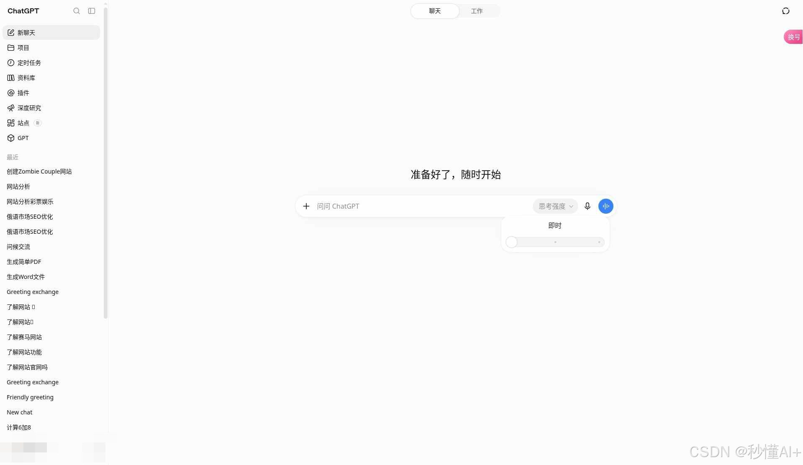

* * *

### 三、工作模式（多工具协作与深度任务）

切换至 **工作** 页签后，系统定位偏向严肃任务与工程协作，提示文案也会转为「我们该做什么？」、「处理任何事务」。

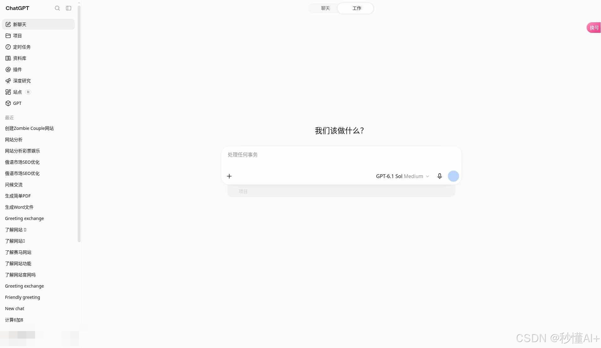

#### 1\. 工作模式核心特性

  * **专业模型配置** ：默认通常搭载 **GPT-6.1 Sol** ，思考档位预设为 **Medium** （兼顾复杂推理与产出效率）；
  * **项目与芯片支持** ：可快捷关联项目上下文；
  * **生态集成建议** ：编辑区支持快速集成与连接 **GitHub、Google Drive、Gmail** 等常用生产力工具。

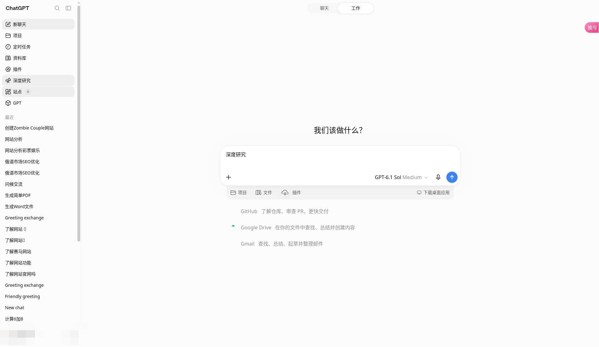

#### 2\. 工作模式可选模型阵容

打开 **选择模型** 菜单，可查看丰富的高阶模型矩阵（具体以账号当前权限为准）：

  * **默认** ：智能推荐的最佳模型组合
  * **GPT-6 系列** ：`GPT-6.1 Sol`、`GPT-6 Astra`、`GPT-6 Sol`、`GPT-6 Luna`
  * **GPT-5 系列** ：`GPT-5.6 Sol / Terra / Luna`、`GPT-5.5`
  * **思考强度档位** ：支持多档微调（Medium 通常为标准第 3 档，共 5 档）

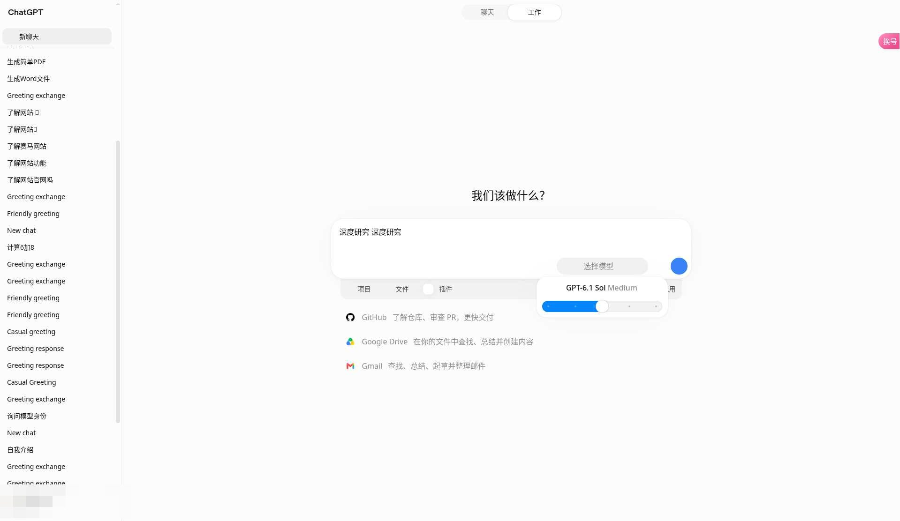

* * *

### 四、侧边栏全功能逐项拆解

进入 Plus 节点后，左侧栏汇集了一系列生产力利器，建议按如下维度深度探索：

#### 1\. 项目（Projects）

集中归档管理关联的多轮对话、提示词与专属文件。支持 **新建、全部、由你创建、与你共享** 视图分类，清晰呈现修改时间与项目状态。

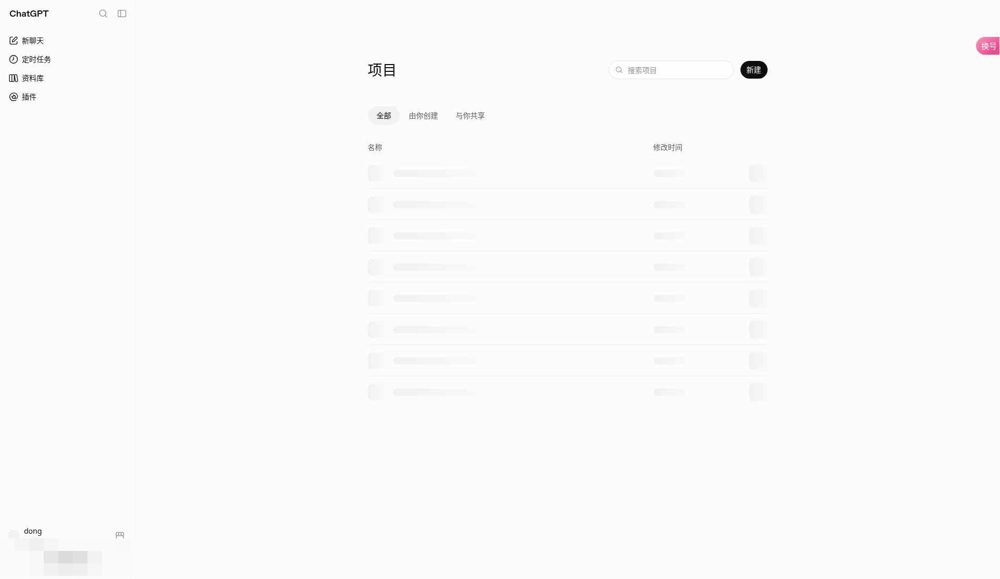

#### 2\. 定时任务（Scheduled Tasks）

让 AI 成为全天候助理：用于**安排定时任务、设置关键提醒、自动化跟踪资讯更新** 。页面清晰划分进行中与历史任务，特别适合周期性巡检与信息追踪。

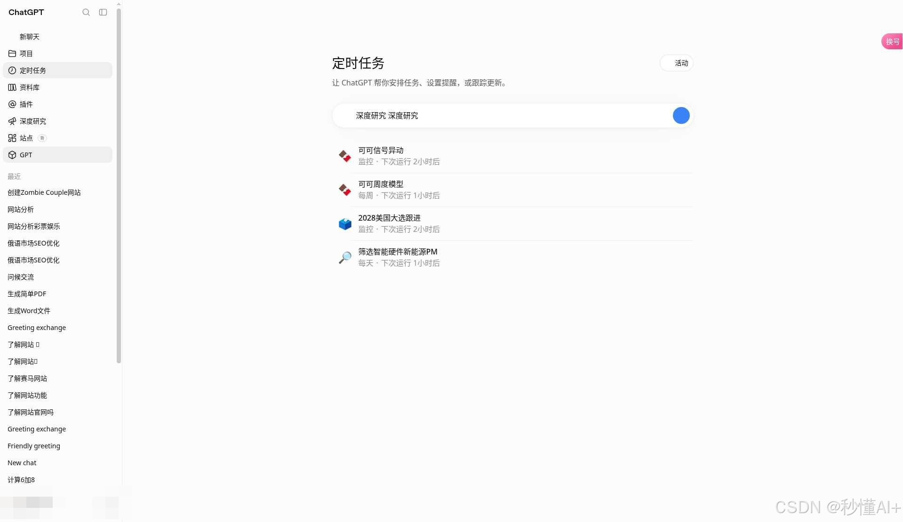

#### 3\. 资料库（Knowledge Base / Files）

集中存储与管理私有**图片与文档资产** 。支持文件批量上传、按名称/大小/时间排序筛选，是构建专属知识库的重要基础设施。

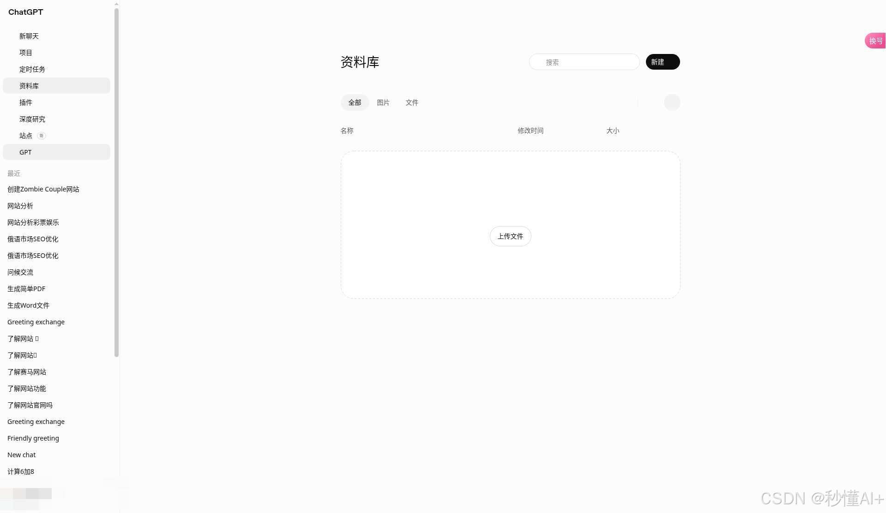

#### 4\. 插件与技能（Plugins & Skills）

连接外部数据世界的桥梁。包含 **插件 | 技能** 双页签，支持检索公开、个人定制与热门插件。生态内原生支持接入 Gmail、Google Drive、GitHub 等核心工具。

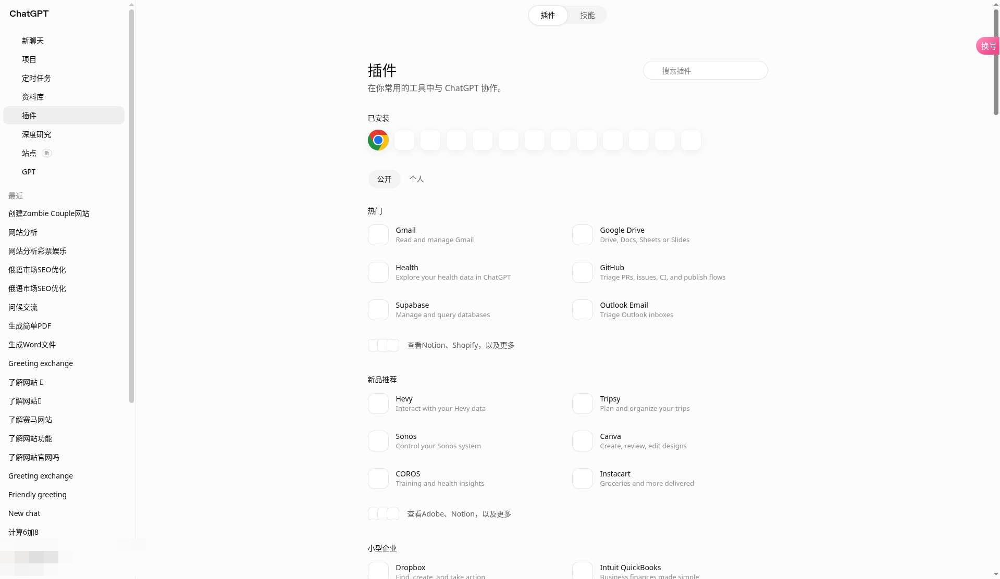

#### 5\. 深度研究（Deep Research）

专为处理高复杂度课题设计。输入研究主题后，AI 将自动进行多轮信息检索、论证与交叉验证，最终输出一份**结构清晰、附带权威引用来源的专业调研报告** 。

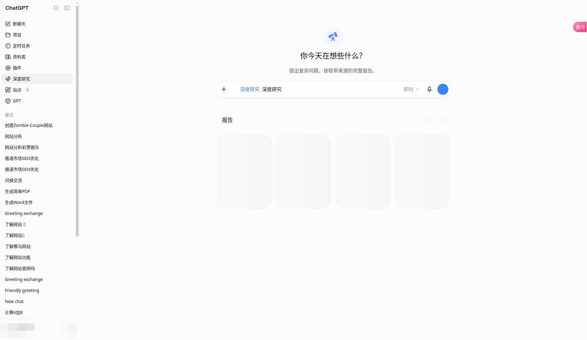

#### 6\. 站点（Websites）

快速将创意落地为网页：支持一键 **创建网站** ，并对已发布站点进行版本维护与管理，零代码快速验证想法。

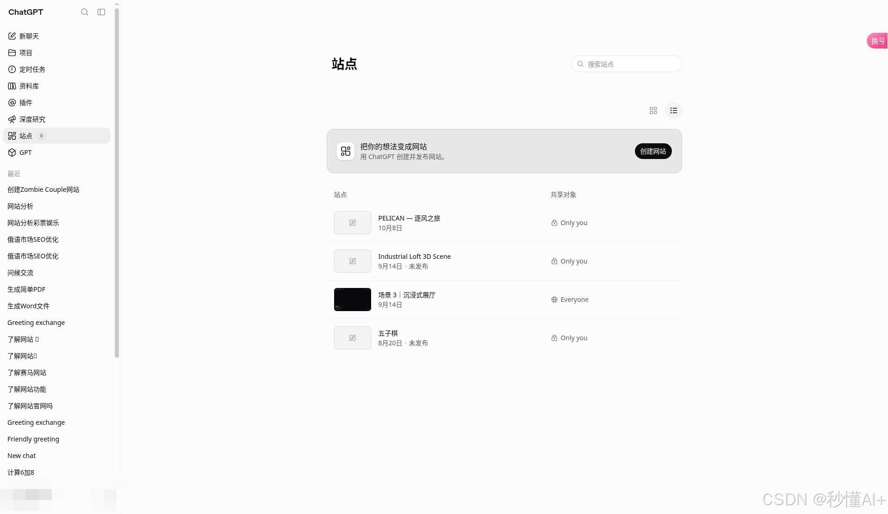

#### 7\. GPTs 生态（探索 / 我的 / 创建）

深入体验自定义智能体生态：

  * **探索 GPT** ：汇聚全网优质智能体，覆盖效率办公、教育研究、代码开发、文案写作、图像设计等垂类；
  * **创建 GPT** ：零门槛通过对话定义你自己的专属 AI Agent。

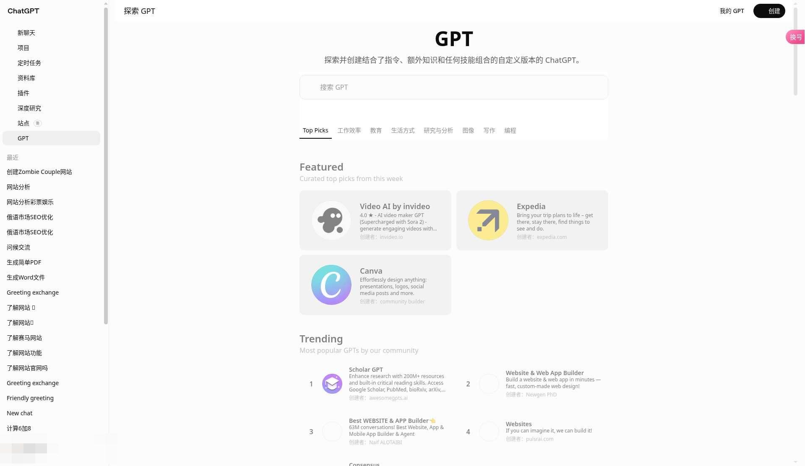

* * *

### 五、无需订阅直接体验：站内 AI 绘图

如果暂时还没有开通 Plus 对话节点权限，侧栏中的 **[AI 绘图](<https://trygpt.asia/list/#/home?product=draw>)** 可以独立使用（具体额度以各账号资产为准）：

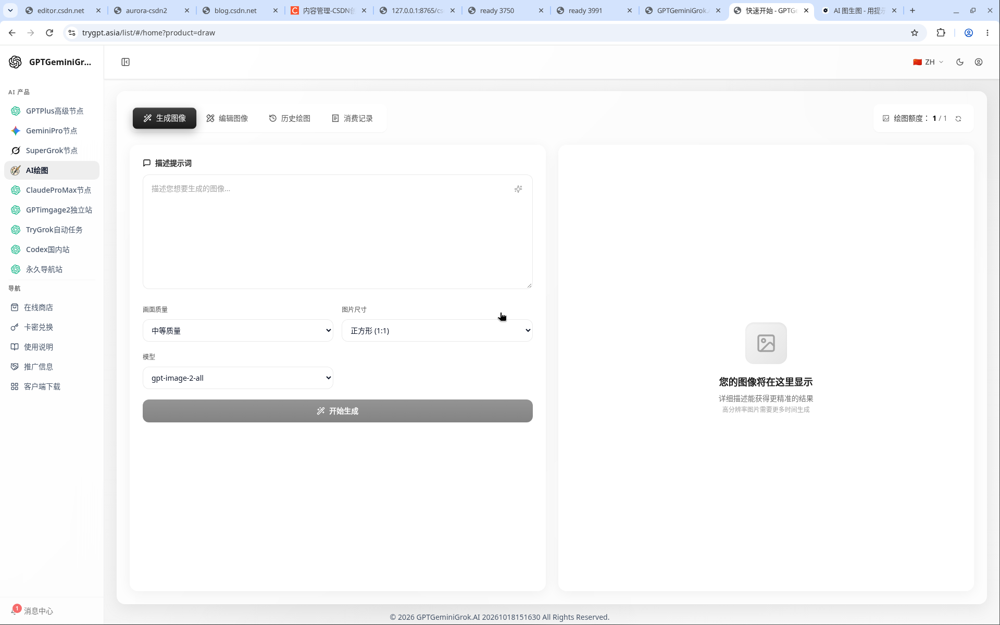

#### 绘图核心参数与配置一览：

功能维度| 选项与支持范围  
---|---  
**功能页签**|  生成图像 / 编辑图像（图像重绘） / 历史绘图 / 消费记录  
**渲染画质**|  低 / 中 / 高  
**画布比例**|  1:1（方形）、2:3、3:2、9:16（手机壁纸/短视频）、1:2  
**内置模型**| `gpt-image-2-all`、`nano-banana`、`gpt-image-1`  
**图片编辑限制**|  支持 JPG / PNG / WEBP / JPEG，单张最大约 10MB  
  
> 🌐 **扩展了解** ：  
>  平台另提供 **GPTimage2 独立站** ：<https://gptimage2.asia/zh>，也可在侧栏直接访问。对于日常使用，以站内 AI 绘图及 Plus 节点为主即可。

* * *

#### 选购与兑换指南：

  1. **多维度筛选** ：商店内支持按产品线（GPT / Gemini / Claude / Grok / Draw / 综合包）及使用周期（天卡 / 周卡 / 月卡 / 季卡 / 年卡）筛选；
  2. **权益核对** ：在套餐详情弹窗中可查验具体模型的调用频率与限额（如 gpt-5、gpt-5-pro、gpt-5-thinking 等限制，具体以弹窗展示为准）；
  3. **卡密兑换** ：购买卡密后，在兑换页直接粘贴并点击 **立即兑换** ，秒级入账开通。

* * *

### 六、个人中心与福利说明

在个人中心里，您还可以掌握更多实用功能：

  * **每日签到** ：每天打卡可免费获赠使用时长或额度（规则以签到页为准）；
  * **用量与限制** ：随时监控当前账号的套餐到期时间、模型调用频率与使用统计看板。

* * *